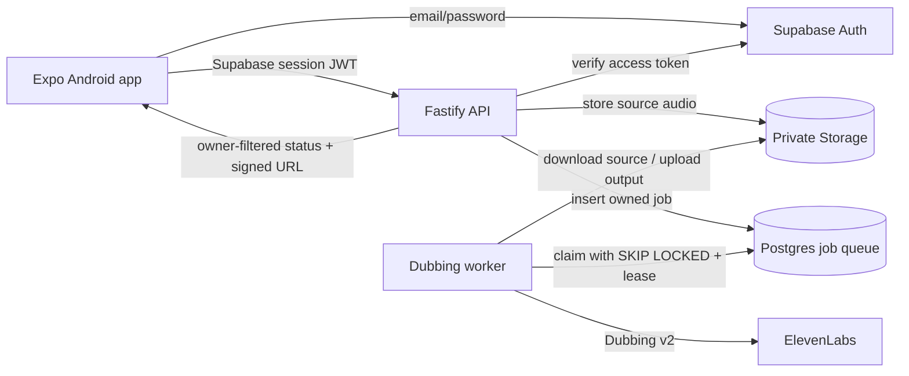

# Durable jobs, authentication and private audio

## Architecture



## Data ownership

Each `voicebridge_jobs` row has a non-null `user_id` foreign key to `auth.users`. The API verifies the caller's bearer token using Supabase Auth and always filters job reads by both job ID and authenticated user ID. The database enables RLS and grants authenticated users read-only access to rows where `auth.uid() = user_id`. Job creation and worker updates use the server-only Supabase secret/service-role key.

Audio objects are stored in the private `voicebridge-private` bucket at:

- `{user_id}/{job_id}/source.{ext}`
- `{user_id}/{job_id}/translated.ogg`

The worker and API access this bucket with the server-only key. The API only creates a 30-minute signed output URL after verifying that the requested job belongs to the caller. Never put the secret/service-role key in Expo configuration.

## Queue reliability

The Postgres claim function uses `FOR UPDATE SKIP LOCKED` to prevent two workers from claiming the same available job. Each claim records a worker ID, increments attempts and sets a two-minute lease. Workers heartbeat every 30 seconds. A worker that dies leaves a processing job that becomes claimable after the lease expires. Jobs are retried with exponential backoff, up to four attempts. A lease that expires after the final attempt is marked failed by the next queue claim.

Provider project and target-language IDs are persisted as soon as they are created. When a worker restarts, it resumes polling the existing Dubbing v2 project/target rather than intentionally creating a new translation. Output uploads use a deterministic path and upsert so a worker can safely repeat the final storage write.

This is a Postgres-backed queue and does not require Redis. Run multiple worker replicas if needed; row locking and worker leases coordinate them.

## Apply the database migration

Apply `supabase/migrations/20261103103000_voicebridge_durable_jobs.sql` to the VoiceBridge Supabase project using the SQL Editor or the linked Supabase CLI migration workflow. It creates the jobs table, indexes, RLS policy, restricted queue RPC functions and private storage bucket.

Supabase changed default Data API exposure behavior in 2026. The migration explicitly grants the required table privileges, but confirm that the `public` schema is included in the project's Data API exposed schemas. Keep RLS enabled.

After applying the migration, verify:

1. `public.voicebridge_jobs` exists and RLS is enabled.
2. `claim_voicebridge_job(text)` and `heartbeat_voicebridge_job(uuid,text)` are executable by `service_role` only.
3. `voicebridge-private` exists and is not public.
4. An authenticated user can select only their own job rows; anonymous users cannot read rows.

## Environment variables

### API and worker (server-side)

Set these on both Railway services:

- `SUPABASE_URL`
- `SUPABASE_PUBLISHABLE_KEY` (or legacy `SUPABASE_ANON_KEY`) — API token verification
- `SUPABASE_SECRET_KEY` (preferred) or legacy `SUPABASE_SERVICE_ROLE_KEY` — server-side database and Storage access
- `SUPABASE_STORAGE_BUCKET=voicebridge-private`
- `ELEVENLABS_API_KEY`
- `FFMPEG_PATH=ffmpeg`

The API also uses `PORT`, `HOST` and `CORS_ORIGIN`.

### Expo mobile app

Set these in `apps/mobile/.env`:

- `EXPO_PUBLIC_API_URL`
- `EXPO_PUBLIC_SUPABASE_URL`
- `EXPO_PUBLIC_SUPABASE_PUBLISHABLE_KEY`

Only the publishable key belongs in the mobile app. The app persists the Supabase session with AsyncStorage and sends the current access token to protected API routes.

## Run locally

Terminal 1 — API:

```bash
cd apps/api
npm install
npm run dev
```

Terminal 2 — worker:

```bash
cd apps/api
npm run dev:worker
```

Terminal 3 — Expo app:

```bash
cd apps/mobile
npm install
npx expo start --tunnel
```

For Railway, deploy two services from `apps/api/Dockerfile` and the same repository commit:

- API service start command: `node dist/server.js`
- Worker service start command: `npm run worker`

The worker has no HTTP listener; do not attach the public API domain to the worker service.

## API contract

- `POST /v1/voice/translate` — requires `Authorization: Bearer <access_token>`; accepts multipart `file`, `sourceLanguage`, `targetLanguage`; stores source audio and queues a job; returns HTTP 202.
- `GET /v1/voice/translations/:id` — requires the same bearer token; returns job state and a signed audio URL only to the owning user.
- `GET /v1/voice/translations` — returns the signed-in user's latest 50 jobs.
- `GET /v1/languages` and `GET /health` remain public.

Current per-user guardrail: 20 translation starts per hour, in addition to the route IP rate limit. Production billing/quotas and account deletion/audio-retention workflows still need to be defined.

## Operational notes

- Supabase Auth email confirmation may be enabled; if so, new users must confirm email before signing in.
- Signed output URLs expire after 30 minutes. The mobile app requests a fresh URL when it polls a completed job.
- The worker retries failures up to four attempts. Inspect API/worker logs and the `voicebridge_jobs.error` field when a job ends in `failed`.
- Add scheduled cleanup for old source/output objects and job rows after defining the product's retention policy.
- Do not expose WhatsApp Business sending until its sender credentials are linked to an authenticated user/business and send jobs/webhooks are persisted.
